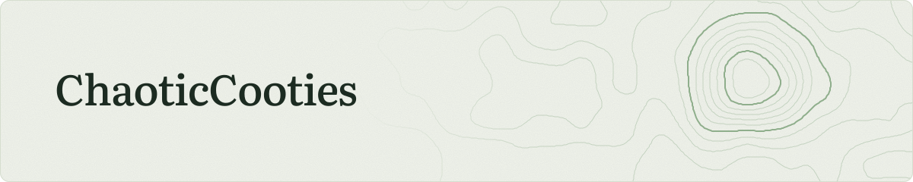

<picture>
  <source media="(prefers-color-scheme: dark)" srcset="assets/banner-simple-dark.svg">
  
</picture>

I'm an offensive security professional and aspiring AI safety researcher in Brisbane, Australia. My areas of interest include adversarial machine learning, offensive agents, and evaluations.

## Writing

<!-- BLOG-POST-LIST:START -->
- **[What an attack success rate leaves out](https://cooties.io/blog/severity-aware-jailbreak-risk/)** · Oct 18, 2026 Measuring repeated jailbreak attempts and the severity of what comes back.
- **[Anatomy of a Jailbreak](https://cooties.io/blog/anatomy/)** · Oct 2, 2026 A meta-analysis of jailbreak tactics, why a frame has to fit the request, and the role of context in multi-turn attacks.
- **[Project Umbra: Retrospective on Supply Chain Tooling Research](https://cooties.io/blog/project-umbra/)** · Apr 21, 2026 Building an agentic vulnerability scanner, finding a real backdoor, and why this kind of work should be standard practice.
- **[Mr Bones, Get Me Off This Wild Ride](https://cooties.io/blog/mr-bones-wild-ride/)** · Mar 25, 2026 Agentic AI, labor economics, and the end of the apprenticeship model.
- **[LLM Pentest Methodology](https://cooties.io/blog/pentesting-llm-applications-part2/)** · Dec 14, 2025 Deep dive into prompt injection attacks, defense bypasses, and exploiting LLM applications - from basic injections to advanced multi-stage attacks combining AI-specific and traditional vulnerabilities.

<!-- BLOG-POST-LIST:END -->

For all posts, see [cooties.io](https://cooties.io) or subscribe to the [RSS feed](https://cooties.io/rss.xml).

## Disclosures

Project Umbra, an agentic supply-chain scanner, found the following vulnerabilities. For full advisories, see [umbra.cooties.io](https://umbra.cooties.io).

| CVE | Affected software | Issue | Severity |
| --- | --- | --- | --- |
| CVE-2026-6443 | WordPress plugins from a compromised account | Backdoored update allows unauthenticated remote code execution | Critical (CVSS 9.8) |
| CVE-2026-102566, CVE-2026-102567 | OpenNMT CTranslate2 | Heap overflows in the model loader, fixed in 4.8.1 | High |

A couple of other high-severity findings are under embargo.
